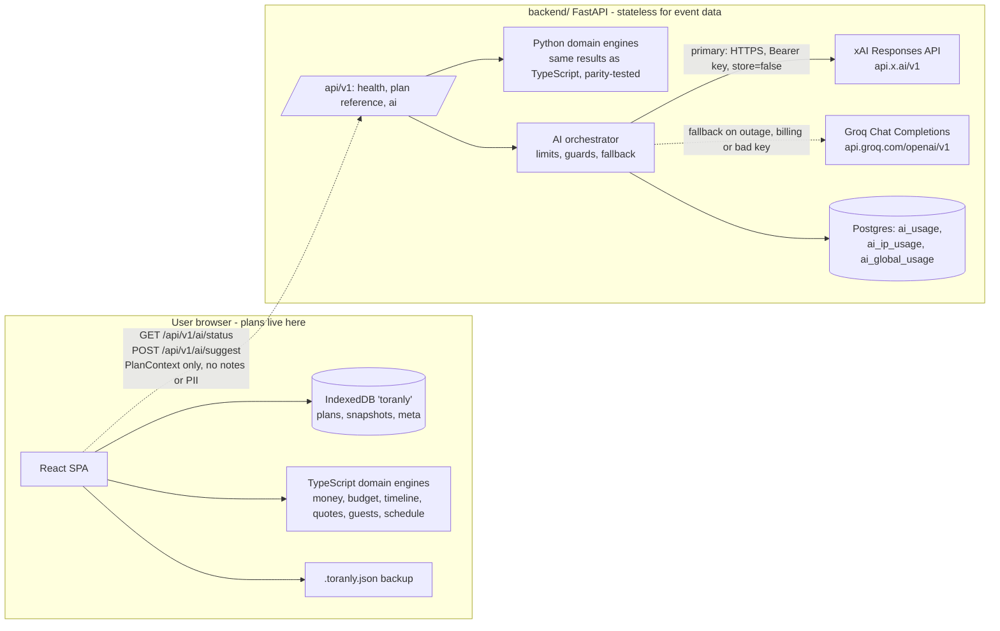
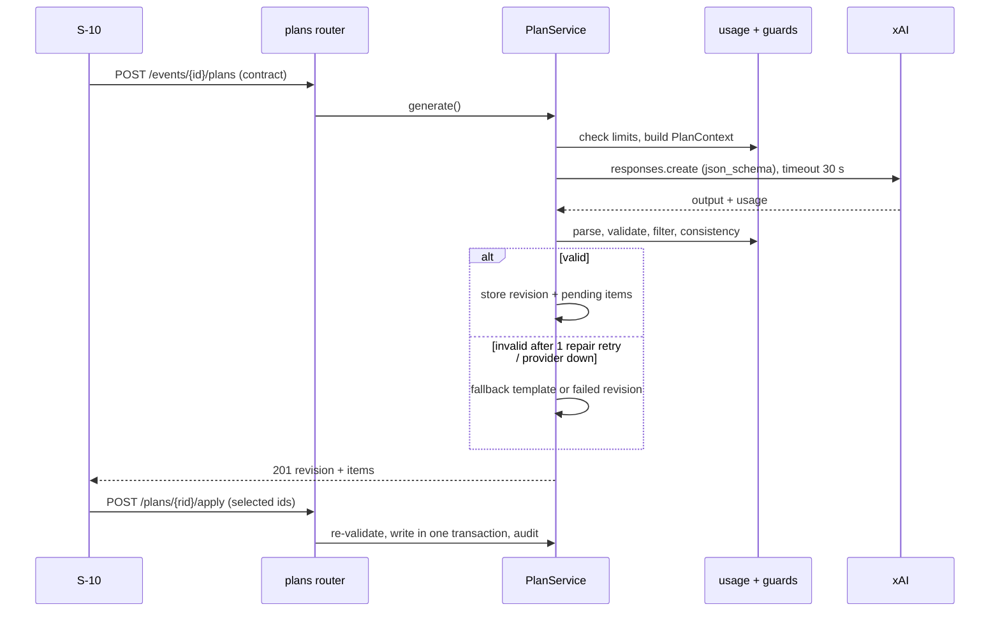
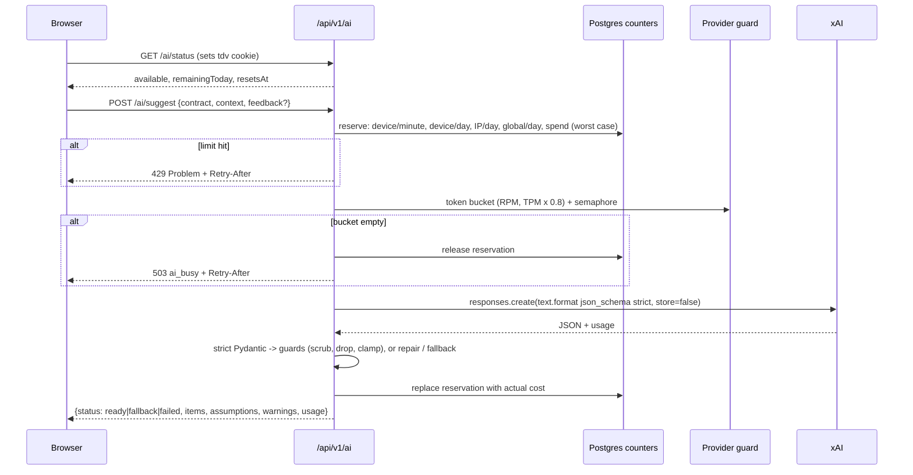

# Architecture

Project: Celebration & Event Planner (temporary name).
Related: [TRD.md](TRD.md), [API.md](API.md), [DATABASE.md](DATABASE.md), [AI_SCHEMAS.md](AI_SCHEMAS.md), [SECURITY.md](SECURITY.md).

## 1. System context



Under Guest-First Planning (Option C) the React SPA works fully on its own with IndexedDB and the TypeScript engines. The backend in `backend/` (§8) is a stateless companion: it never stores plans, only AI usage counters, and it is the only place the xAI key exists. There are no user accounts in this phase.

## 2. Components

```mermaid
flowchart TB
  subgraph Web[web/ React SPA]
    R[Routes & Screens] --> STORE[Storage Layer / idb]
    STORE --> IDB[(IndexedDB 'toranly')]
    STORE --> MEM[(In-Memory Fallback)]
    R --> DM[Domain Engines / TypeScript<br/>money, budget, timeline, quotes, guests, schedule, export]
    R --> EXP[CSV & .toranly.json Exporters]
  end
  subgraph API[app/ FastAPI (Optional Backend)]
    RT[api/v1 routers] --> SV[services]
    SV --> AI[ai orchestrator]
    AI --> PR[xAI provider adapter]
    SV --> RP[repositories]
    RP --> DB[(Postgres)]
  end
  R -.->|Stateless AI Request| RT
```

## 3. Repository tree

> Phase 3 is implemented in `backend/` with the layout in §8. The tree below is the earlier account-based design, kept as the plan for the later optional sync phase (`services/`, `repositories/` and the event tables do not exist yet).

```
.
├── app/
│   ├── main.py                 # app factory, middleware, static files, error handlers
│   ├── api/v1/                 # one router per resource: auth, account, events, functions, budget,
│   │                           # expenses, tasks, vendors, quotes, guests, schedule, ideas, plans, export, health
│   ├── schemas/                # Pydantic request/response models (API contracts)
│   ├── domain/                 # pure Python, no I/O, fully unit tested
│   │   ├── money.py            # paise arithmetic, largest-remainder split, INR formatting for CSV
│   │   ├── templates.py        # per-event-type categories (%), tasks (offset_days, deps)
│   │   ├── budget_engine.py    # allocations, committed, remaining, status, overrun
│   │   ├── timeline_engine.py  # due dates from offsets, date-change preview, overdue
│   │   ├── dependency_graph.py # cycle detection (Kahn), completion gating
│   │   ├── quote_compare.py    # normalisation per guest/plate, missing inclusions
│   │   ├── guests.py           # diet totals, coverage vs menu ideas
│   │   └── schedule.py         # overlaps, window checks
│   ├── services/               # use cases and transaction boundaries
│   │   ├── event_service.py, template_service.py, budget_service.py, task_service.py,
│   │   ├── vendor_service.py, guest_service.py, schedule_service.py, idea_service.py,
│   │   ├── plan_service.py     # generate, revise, apply, reject (AI orchestration entry)
│   │   └── export_service.py   # CSV
│   ├── repositories/           # SQLAlchemy queries, owner-scoped
│   ├── ai/
│   │   ├── provider.py         # Protocol: generate(contract, context) -> RawResult
│   │   ├── xai_client.py       # OpenAI SDK with base_url, timeouts, retries, circuit breaker
│   │   ├── context.py          # builds PlanContext from DB state (data minimisation)
│   │   ├── contracts/          # Pydantic output models (AI_SCHEMAS.md)
│   │   ├── prompts/            # versioned prompt text
│   │   ├── guards.py           # filters and consistency checks
│   │   └── usage.py            # limits and token accounting
│   ├── core/                   # config (pydantic-settings), security (sessions, CSRF, hashing),
│   │                           # errors (Problem Details), logging (JSON, redaction), rate_limit
│   └── db/                     # models.py, session.py, alembic/
├── web/                        # React + TypeScript + Vite
│   └── src/ (routes/, screens/, components/, api/, styles/tokens.css, lib/format.ts)
├── tests/                      # unit/, contract/, integration/, ai/ (fixtures with recorded outputs)
├── e2e/                        # Playwright specs and axe checks
├── Dockerfile                  # multi-stage: build web, then python:3.14-slim runtime
├── .env.example
└── docs (this package at repository root and design/)
```

## 4. Deterministic vs AI vs user-confirmed

| Computation | Owner |
|---|---|
| Template categories and tasks | Deterministic (`templates.py`) |
| Splitting total into category allocations | Deterministic (`money.split`) |
| Committed, paid, remaining, status | Deterministic (§4.2) |
| Due dates, date-change preview, overdue | Deterministic |
| Dependency cycles and gating | Deterministic |
| Quote normalisation | Deterministic |
| Diet totals and coverage | Deterministic |
| Schedule overlaps | Deterministic |
| Theme, decor, menu, saving ideas, task wording, budget share proposals | AI, then deterministic validation |
| Writing any AI item into user data | User confirmation (E-73, D-08) |
| Date change, deletes | User confirmation |

### 4.1 Money split
`split(total_paise, shares)` multiplies, floors, then gives remaining paise to the largest fractional remainders (ties by category position). Sum always equals total.

### 4.2 Budget rules (single definition)
Per category: `planned`, `quoted`, `paid` are sums of expenses by kind. `committed = max(paid, quoted, planned)` [D: the most concrete known amount, avoiding double counting when a planned figure is later quoted and paid]. `remaining = allocated - committed`. Status: `over` if committed > allocated; `warning` if allocated > 0 and committed >= 90% of allocated; else `ok`. A category with allocation 0 and committed > 0 is `over`. Totals sum the per-category values; overall status uses the same rule on totals. Thresholds in config [A].

### 4.3 Date change
For `date_mode=relative`: `due = event_date - offset_days`. Fixed tasks keep their date unless `shift_fixed_tasks` is true, in which case they move by the same day delta. Preview and apply share one function so results match.

## 5. AI orchestration

> Implemented flow (guest-first, §8.3): `POST /api/v1/ai/suggest` → limits → provider guard → xAI → validation → guards → response. No revisions are stored; the browser keeps suggestions and applies accepted ones locally. The diagram below is the later account-based variant.



Timeouts: per call 30 s, whole request 45 s. Circuit breaker: in-process, opens after 5 consecutive failures for 60 s (resets on restart; acceptable for one instance).

## 6. Failure handling

| Failure | Handling |
|---|---|
| DB unavailable (Neon waking from scale to zero) | psycopg connect timeout 10 s, one retry; `pool_pre_ping=True`; readiness reports 503 |
| Neon Free compute limit reached | All DB calls fail; app shows ST-02; documented operational risk |
| xAI errors | AI_SCHEMAS.md §7 |
| Unhandled exception | Problem Details 500 with request id; stack trace to logs only |
| Instance restart (Render may restart free services) | Stateless app. AI usage counters live in Postgres and survive restarts. In-memory state resets on restart [A, acceptable]: the general per-IP limit (`API_LIMIT_PER_IP_PER_MINUTE`, default 60/min), the xAI provider token bucket, the circuit breaker and the "AI disabled after 401/403" flag |

## 7. Deployment

| Item | Choice |
|---|---|
| App host | Render Free web service, Docker runtime [D] (RR §8.3) |
| Database | Neon Free, region closest to the Render region [A: pick Singapore if both offer it; verify] |
| Release | The container runs `alembic upgrade head` (first connection retried for about a minute while Neon wakes; a Postgres advisory lock so concurrent starts migrate once), then `uvicorn app.main:app_factory --factory --host 0.0.0.0 --port $PORT` |
| Health | `/api/v1/health` liveness (Docker `HEALTHCHECK`, Render health check path); `/api/v1/health/ready` database and provider states |
| Transfer | GZip for responses over 1 KB; fonts ship as files, never `data:` URIs (the CSP `font-src 'self'` blocks those) |
| Secrets | Render environment variables (TRD.md §6) |
| Static files | React build copied into the image and served by FastAPI with long cache headers for hashed assets and `no-cache` for `index.html` |
| CI | GitHub Actions: lint, type-check, tests, build image; deploy via Render deploy hook on main |

Cold starts: Render Free sleeps after 15 minutes idle and needs about a minute to wake [V]; Neon scales to zero after 5 minutes and also wakes on connect. Mitigation for demos: open the app about 2 minutes before presenting. The product does not use automated keep-alive pings.

Free-tier boundaries: Render 750 instance hours per workspace per month covers one always-awake service [V]; Neon 100 CU-hours per project per month [V]. Neither bills automatically on the free plan; services suspend instead (RR §8.3).

Alternative: Google Cloud Run only when a billing account already exists. Same Docker image; needs Artifact Registry, a service account and a budget alert. Overage is billed to the card [V: billing account required].

## 8. Backend (Phase 3, guest-first, implemented)

### 8.1 Folder

```
backend/
  app/main.py            app factory: SecurityMiddleware (request id, headers, Origin, 413, 500s),
                         CORS (development only), routers, Problem Details, SPA static serving
  app/core/              config.py, security.py, ratelimit.py, errors.py, logging.py, clock.py
  app/api/v1/            health.py, plan.py (+ plan_models.py), ai.py
  app/domain/            money, templates, budget_engine, timeline_engine, dependency_graph,
                         quote_compare, guests, schedule  (pure Python, parity with web/src/domain)
  app/ai/                provider.py, xai_client.py, context.py, contracts/, prompts/*.v1.txt,
                         guards.py, usage.py, orchestrator.py
  app/db/                models.py (3 usage tables), session.py, cleanup.py, alembic/
  tests/                 unit/, api/, ai/, db/, parity/fixtures/*.json (shared with Vitest)
  Dockerfile             node build stage + python:3.14-slim runtime, non-root
```

### 8.2 Stateless design

- Requests carry everything they need (the plan, or a `PlanContext`); nothing about an event is written anywhere.
- Server state is limited to `ai_usage`, `ai_ip_usage` and `ai_global_usage` (DATABASE.md §0). Rows older than 30 days are deleted daily.
- Identity is a random device id in a signed HttpOnly cookie (`tdv`); only its SHA-256 is stored. IPs are stored only as salted HMAC hashes.
- In-process state (provider token bucket, circuit breaker, general API limiter, "AI disabled after 401/403") resets on restart; the Postgres counters do not.

### 8.3 Request flow for AI



### 8.4 Deployment

One Docker image (`backend/Dockerfile`, built from the repository root) builds `web/` and serves `web/dist` from FastAPI on the same origin, with `no-cache` for `index.html` and immutable caching for `/assets/*`. The container runs `alembic upgrade head` and then Uvicorn as uid 10001. Render (Docker runtime) and Neon Postgres as in §7; settings in backend/README.md, step by step in DEPLOYMENT.md. In development, Vite proxies `/api` to `localhost:8000`.

### 8.5 Frontend and backend data flow (Nov 2026)

| Screen action | Browser | Backend |
|---|---|---|
| Wizard: Finish | builds the plan, saves to IndexedDB | `POST /plan/template` replaces the budget split and starter tasks (browser template only offline) |
| Overview and Budget totals | instant figures after an edit | `POST /plan/summary` (debounced 400 ms) is what the screen shows |
| Change date | instant preview | `POST /plan/date-preview`; Confirm waits for it |
| Import backup, Print | zod schema check | `POST /plan/validate` (errors block an import; problems are listed above the print view) |
| AI plan, Ideas | consent, review, apply locally | `GET /ai/status`, `POST /ai/suggest` |

When the backend is unreachable every screen keeps working on IndexedDB and says "Live check unavailable. Showing figures calculated on this device." A new visitor starts empty: the wizard has no example values. Routes after the landing page, the AI plan tab and the mobile menu load on demand.
