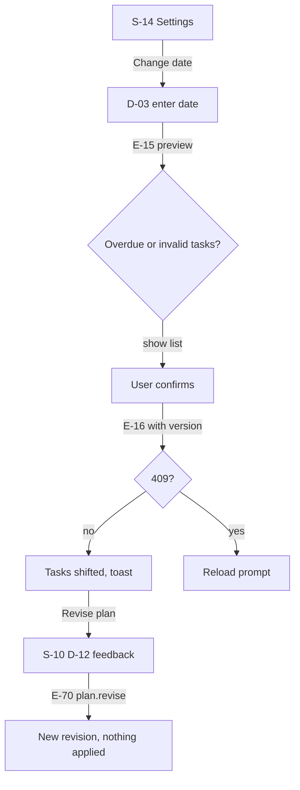
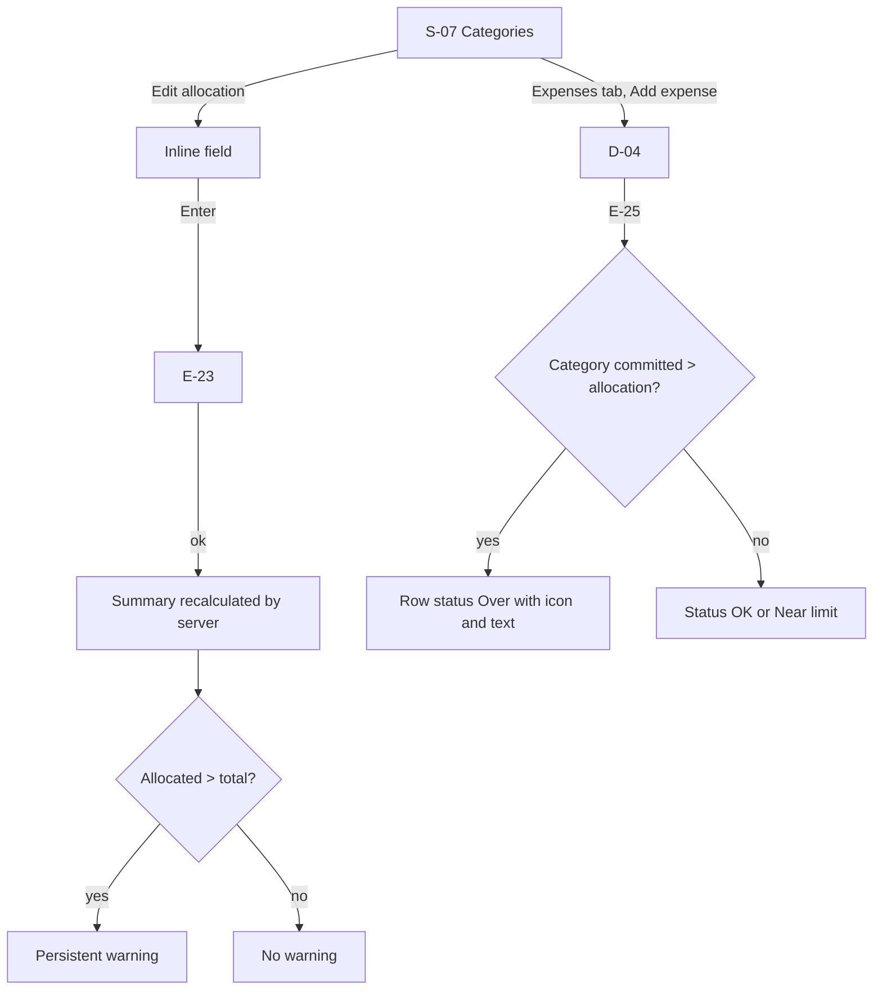
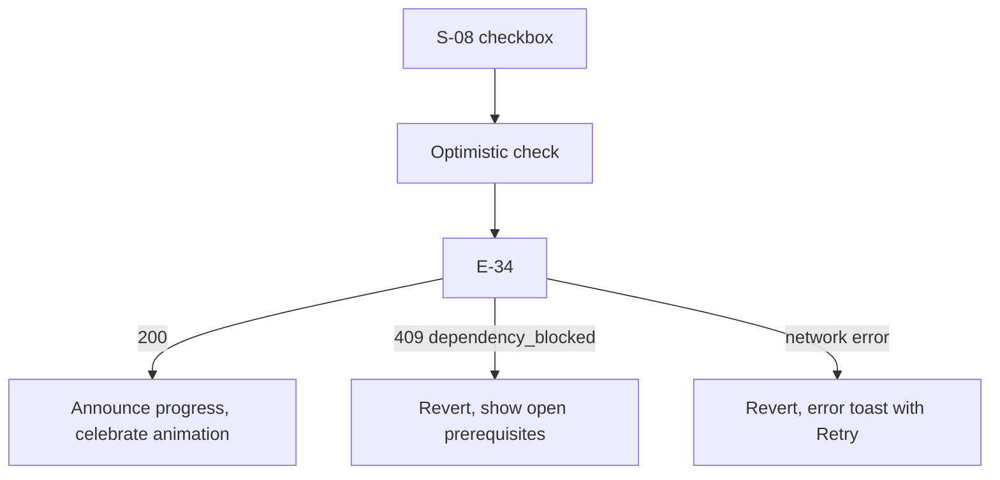
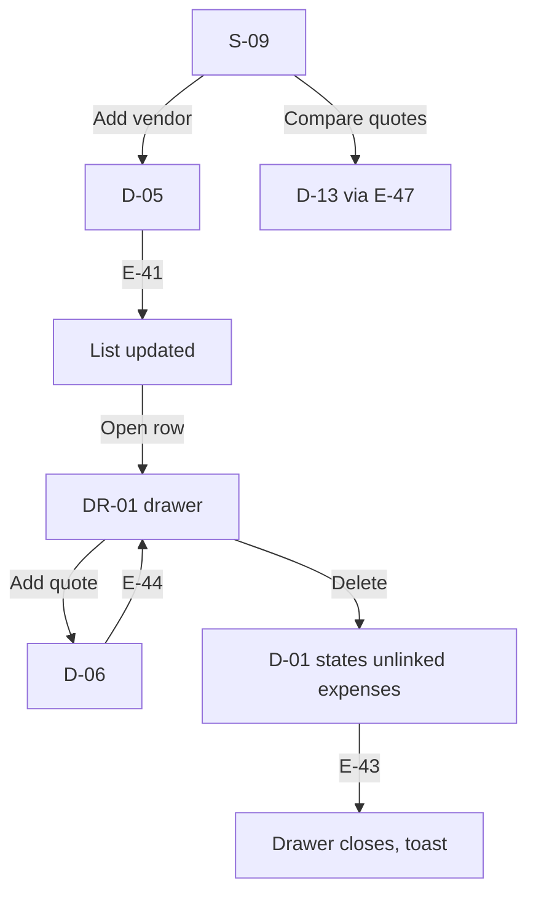
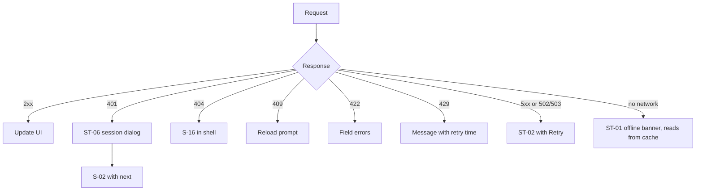

# UX Flows

Project: Celebration & Event Planner (temporary name).
Related: [PRD.md](PRD.md), [API.md](API.md), [design/DESIGN_SYSTEM.md](design/DESIGN_SYSTEM.md), [ACCESSIBILITY.md](ACCESSIBILITY.md).
UX outcomes are design decisions, not tested findings (RR §0).

## 1. Information architecture

### 1.1 Routes

| Screen | Route | Mode (Option C Guest-First) |
|---|---|---|
| S-01 Landing | `/` | Public. "Start planning" always opens wizard step 1 (`/events/new`). "My plans" link shown if plans exist. |
| S-02 Sign in | `/login` | Redirects to `/events/new` (`FEATURE_ACCOUNTS = false`). |
| S-03 Register | `/register` | Redirects to `/events/new` (`FEATURE_ACCOUNTS = false`). |
| S-04 My Plans Dashboard | `/events` | Browser Local (IndexedDB). Open, create, import, backup, delete. |
| S-05 Create event wizard | `/events/new` (step 1), `/events/:eventId/setup?step=2..4` | Browser Local. Autosaves draft. |
| S-06 Event overview | `/events/:eventId` | Browser Local. Summary, countdown, quick actions. |
| S-07 Budget | `/events/:eventId/budget?tab=categories\|expenses` | Browser Local. Categories & Expenses, Add expense (D-04), CSV download. |
| S-08 Timeline | `/events/:eventId/timeline?filter=open\|done\|all` | Browser Local. Tasks, Add task (D-07), completion gating, CSV download. |
| S-09 Vendors | `/events/:eventId/vendors` | Browser Local. Directory & quotes comparison (cheapest marked). |
| S-10 AI plan review | `/events/:eventId/plan` | Stateless / Offline shell with privacy notice. |
| S-11 Guests and dietary | `/events/:eventId/guests` | Browser Local. Dietary steppers and coverage validation. |
| S-12 Schedule | `/events/:eventId/schedule` | Browser Local. Function schedules & overlap detection. |
| S-13 Ideas | `/events/:eventId/ideas` | Browser Local. Theme, decor, and menu concepts. |
| S-14 Event settings | `/events/:eventId/settings` | Browser Local. Date change (D-03), snapshot restore, backup, delete (D-01). |
| S-15 Print plan | `/events/:eventId/print` | Print / PDF (A4 `@media print`, sections 1–9 omitting empty ones). |
| S-16 Not found | any other path | Public. |

Draft events (status `draft`) opened at any event route redirect to `/events/:eventId/setup?step={wizard_step}`.

### 1.2 Dialogs, drawers and states (no own route)

| ID | Name | Used in |
|---|---|---|
| D-01 | Delete confirmation | S-07, S-08, S-09, S-12, S-13, S-14, S-15 |
| D-02 | Unsaved changes | Any form with more than one field |
| D-03 | Date change preview | S-14 |
| D-04 | Expense form | S-07 |
| D-05 | Vendor form | S-09 |
| DR-01 | Vendor detail drawer (quotes) | S-09 |
| D-06 | Quote form | DR-01 |
| D-07 | Task form | S-08 |
| D-08 | Apply AI changes | S-10 |
| D-09 | Category form | S-07 |
| D-10 | Schedule item form | S-12 |
| D-11 | Function form | S-05 step 2, S-12, S-14 |
| D-12 | Revise plan feedback | S-10 |
| D-13 | Quote comparison | S-09 |
| D-14 | Idea form | S-13 |
| D-15 | Storage notice dialog | S-04, S-06 (one-time local storage reminder) |
| D-16 | Import conflict resolution | S-04 (Replace vs Keep both) |
| ST-01 | Offline banner | Global |
| ST-02 | API error panel | Any data region |
| ST-03 | AI failure panel | S-10 |
| ST-04 | Empty states | S-04, S-07, S-08, S-09, S-12, S-13 |
| ST-05 | Toast | Global |
| ST-06 | Session expired | Global |
| ST-07 | In-memory storage mode banner | Global (persistent warning if IndexedDB is blocked) |

### 1.3 Navigation model [D]

- Desktop (1024px and up): left sidebar 248px. Top: product name text, event selector. Items: Overview, Budget, Timeline, Vendors, Guests, Schedule, Ideas, AI plan, Settings. Bottom: account menu (Account, Sign out).
- Tablet (768 to 1023px): sidebar collapses to a 72px icon rail with labels in tooltips and visible on focus; top bar holds the event selector.
- Mobile (under 768px): top app bar (back button on detail views, event selector, account menu). Bottom bar with 5 items: Overview, Budget, Tasks, Vendors, More. More opens a sheet with Guests, Schedule, Ideas, AI plan, Settings.
- Event selector: a button showing the current event title; opens a listbox of the user's events plus "All events" (to S-04) and "New event" (to S-05). Choosing an event keeps the current section when it exists.
- Breadcrumbs: none. The app is two levels deep; the sidebar and page title provide location. Drawers have a close button and Esc.
- Back and Cancel: Cancel in a dialog closes it and returns focus to the trigger. Browser Back follows routes; dialogs and drawers with query params (vendor drawer) close on Back.
- Refresh and direct links: every screen loads from the URL. The last event id is stored in localStorage only to choose the default event on S-04 "Continue planning".
- After create: S-06 with the starter-plan card. After AI apply: stay on S-10. After save in a dialog: dialog closes, list updates, toast. After event delete: S-04 with toast.
- Focus: on route change focus moves to the page `h1`; on dialog close focus returns to the trigger; on item delete focus moves to the next item, or the list heading if none remain.

## 2. Global behaviour

| Situation | Behaviour |
|---|---|
| Loading | Skeleton shapes after 300 ms; no spinner-only pages |
| API error on a read | ST-02 inside the region: title, plain message, Retry button (refetch). Other regions keep working |
| API error on a write | Dialog stays open, values kept, inline error at top of form plus field errors |
| Offline | ST-01 sticky banner "You're offline. Changes can't be saved right now." Save buttons disabled with reason in their description. Cached data stays visible. Banner disappears and data refetches when online |
| Session expired (401) | ST-06 dialog "Your session ended. Sign in again." Button goes to `/login?next=<current path>`. Unsaved form values are kept in sessionStorage for that form and restored after login [D] |
| 404 from API | S-16 content within the shell with link to S-04 |
| Unsaved changes | D-02 on in-app navigation away from a dirty multi-field form: "Discard changes?" Keep editing (default focus) or Discard. Browser close or reload uses `beforeunload` |
| Toasts | Bottom-centre on mobile, bottom-right on desktop. Success toasts auto-hide after 5 s and pause on hover or focus. Errors never auto-hide. Announced via `role="status"` |

## 3. Screen specifications

Each screen lists: purpose, entry, layout, content, actions (label, icon, result), validation, states, API, DB, AI, navigation, back, responsive, accessibility, acceptance. Shared shell rules in §1.3 apply.

### S-01 Landing
- Purpose: explain the product and start planning immediately. Entry: anyone.
- Layout: header (product name, "My plans" link if plans exist), hero (h1, one-line value statement, primary button), three feature rows (budget, timeline, AI ideas you approve) with Lucide icons, footer.
- Actions: "Start planning" (pill primary, router link) to S-05 Step 1 (`/events/new`) always. "My plans" (header/drawer) to S-04 if plans exist on this device.
- States: static. API/DB/AI: none.
- Responsive: single column under 768px. Accessibility: one h1; links are real links.
- Acceptance: "Start planning" reaches `/events/new` without full page reload; Lighthouse accessibility check has no failures.

### S-02 Sign in and S-03 Register
- Fields: email, password (show/hide toggle button with `eye`/`eye-off`, accessible name "Show password"). Register adds timezone (default Asia/Kolkata).
- Validation: email format; password 10 to 128 chars (register). Errors inline below fields and summarised at top on submit.
- Actions: "Sign in" / "Create account" (pill primary, full width on mobile). Links between the two screens.
- API: E-04 / E-03. DB: sessions, users. Success: to `next` param if same-origin path, else S-04.
- Errors: 401 on login shows "Email or password is incorrect." (no hint which). 409 on register shows "An account with this email exists. Sign in instead." with link.
- Accessibility: `autocomplete` attributes; paste allowed (WCAG 3.3.8).
- Acceptance: password managers fill both fields; wrong password does not reveal account existence.

### S-04 Dashboard
- Purpose: list events and start new ones. Entry: after login or "All events".
- Layout: page title "Your events", primary button "Plan a celebration" (icon `plus`), event cards in a grid (1 column mobile, 2 tablet, 3 desktop).
- Card content: type icon and label, title, date and days remaining, budget health text ("₹4.2 L of ₹7.5 L committed", status chip with icon), open tasks count. Whole card is one link to S-06 (or setup step for drafts, labelled "Draft: continue setup").
- Empty state (ST-04): illustration-free; heading "No celebrations yet", one sentence, primary "Plan a celebration", plus three template shortcuts (Wedding, Birthday, Community event) that open S-05 with type preselected.
- API: E-10. Errors: ST-02.
- Acceptance: events sorted by nearest upcoming date, past events last; drafts marked.

### S-05 Create event wizard
- Purpose: create an event in 4 short steps (FR-EVT-01). Progress indicator "Step 2 of 4" with step names; completed steps are links back.
- Entry: Direct visit to `/events/new` always starts fresh wizard at step 1. If saved plans exist on this device, step 1 shows a quiet line above the heading: "You have N saved plans on this device. Open My plans" (linking to `/events`). Visiting `/events/new` creates no plan in IndexedDB until step 1 is completed (type chosen, name entered, and "Continue" clicked).
- Step 1 Type and name: radio cards for 6 event types (icon plus label); title field. "Continue" validates, saves initial plan to IndexedDB, then routes to `/events/:id/setup?step=2`.
- Step 2 Details: date (date input, min today), city (optional), functions section (optional, wedding and engagement show it expanded): "Add function" opens D-11. "Continue" calls E-13 with `wizard_step: 3`.
- Step 3 Budget and guests: total budget (INR input with live Indian grouping preview), guest estimate, optional diet split (collapsed "Add food preferences"). Validation: budget 0 to 99,99,99,999 rupees; guests 1 to 10000; diet sum not above guests.
- Step 4 Preferences: theme words (up to 5 chips), colours to avoid, customs to include (free chips, optional, with helper text "Only what you choose is used."), notes (500 chars, counter). "Finish setup" calls E-13 with `finalize: true`.
- Secondary actions: "Back" (to previous step, no save prompt because each step saves), "Save and exit" (to S-04).
- Loading: button busy state. Errors: inline; step stays.
- Success: S-06 with starter-plan card (N-07).
- Responsive: single column all widths; max width 640px.
- Accessibility: each step's heading receives focus; radio cards are native radios.
- Acceptance: refresh on any step restores entered values; finishing creates categories that sum exactly to the budget and tasks with due dates.

### S-06 Event overview
- Purpose: one-glance status. Layout: header (title, date, type chip, countdown "111 days to go" using rani accent), then four sections without nested cards: Budget health (allocated, committed, remaining; bar with text values), Next tasks (5 nearest open tasks with checkboxes), Vendors (count by status), Guests (total, diet coverage warning if any).
- Starter-plan card (first visit after creation, dismissible): "Your starter plan is ready. Want ideas from AI?" Buttons "Get AI ideas" (to S-10 and triggers plan.generate) and "Not now" (dismiss; stored in localStorage per event).
- Actions: section headings link to their screens ("View budget" etc.). Checkbox completes task (E-34) inline.
- API: E-12, E-21, E-30, E-40, E-50 (parallel). Each section has its own error state.
- Acceptance: numbers match S-07 exactly; completing a task updates both screens.

### S-07 Budget
- Tabs: Categories, Expenses (`tab` query param).
- Summary bar (sticky on desktop): Total budget, Allocated, Committed, Paid, Remaining, Unallocated, overall status chip.
- Categories tab: table (Category, Allocated, Committed, Paid, Remaining, Status, actions). Allocated cell is an inline edit: click or Enter opens a number field; Enter or blur saves (E-23); Esc cancels. Row menu (icon `ellipsis`, name "Actions for Catering"): Rename (D-09), Move up, Move down, Delete (D-01; 409 shows "Move or delete its 3 expenses first.").
- Allocation warning: when allocated total exceeds total budget, a persistent inline warning above the table: "Allocations exceed your total by ₹25,000." Save still allowed.
- Expenses tab: filter by category and kind; table (Date, Description, Category, Vendor, Kind, Amount, actions). "Add expense" (pill primary, `plus`) opens D-04. Row actions Edit (D-04), Delete (D-01).
- D-04 fields: description, amount, kind (radio: Planned, Quoted, Paid), category (select), vendor (optional select), date, note.
- Empty states: Expenses: "No expenses yet. Add your first planned or paid amount." with "Add expense".
- API: E-21 to E-27. DB: budget_categories, expenses.
- Responsive: under 640px tables reflow to stacked rows (ACCESSIBILITY.md §6).
- Acceptance: summary equals Python engine output for fixture data (TESTING.md T-BUD).

### S-08 Timeline
- Layout: filter segmented control (Open, Done, All), group by month relative to event ("4+ months before", "1 month before", "Final week", "Event day"). Milestones show a marigold chip "Milestone".
- Row: checkbox (complete or reopen), title, due date, overdue chip (icon `alert-circle` plus "Overdue"), dependency hint ("Waiting on: Book venue"), row menu (Edit, Move up, Move down, Delete).
- Completing: optimistic check with 400 ms celebrate animation; on 409 `dependency_blocked` the checkbox reverts and an inline message names the open prerequisites.
- "Add task" opens D-07: title, due mode (Days before event / Specific date), value, category, milestone toggle, prerequisites (multi-select), notes. Cycle error 422 shown on the prerequisites field.
- Empty state: "No tasks yet" with "Add task" and "Get AI task ideas" (to S-10 with `timeline.suggest`).
- API: E-30 to E-35.
- Acceptance: progress count updates and is announced; reorder works by keyboard.

### S-09 Vendors
- Layout: category filter chips; vendor list grouped by category; each row shows name, status chip, best quote (normalised total), phone as `tel:` link.
- "Add vendor" opens D-05 (category, name, phone, email, status, notes). Row click opens DR-01 drawer: details, Edit, Delete, quotes list, "Add quote" (D-06: amount, unit, units, inclusions chips, valid until).
- "Compare quotes" button per category (enabled with 2 or more quotes) opens D-13: comparison table from E-47 with cheapest row marked by icon and text "Lowest".
- Delete vendor (D-01) states: "3 expenses will stay in your budget without a vendor."
- Empty state: "No vendors yet" with "Add vendor" and "Which vendors do I need?" (to S-10 with `vendors.categories`).
- API: E-40 to E-47.
- Acceptance: drawer opens from direct link `?vendor=id`; Back closes it.

### S-10 AI plan review
- Purpose: generate, review and apply AI suggestions (FR-AI-01 to 05).
- Layout: header with contract picker (segmented or select: Full plan, Budget split, Tasks, Theme and decor, Menu, Vendor types, Saving ideas, Day-of schedule), "Generate" (pill primary, icon `lightbulb`), revision selector ("Revision 3, today 14:05"). Body: items grouped by kind; each item shows content, "Estimate" chip where relevant, and Accept and Reject toggle buttons (`aria-pressed`). Footer bar: "3 selected", "Apply selected" (pill primary), "Revise with feedback" (secondary, opens D-12).
- Generation progress: inline panel with indeterminate bar and staged text every 4 s ("Reading your event details", "Drafting suggestions", "Checking numbers"). Cancel is not offered because the request is short; navigation away is allowed and the revision appears when done.
- D-08 Apply confirmation: lists counts by type and budget changes table (category, current, new). "Apply changes" calls E-73. Success toast "5 suggestions added" with link "View timeline". Items show "Added".
- Reject: toggles to rejected; optional reason field appears inline; "Undo" in toast for 10 s calls E-75.
- Fallback and failure: ST-03 (AI_SAFETY.md §6).
- Empty: "No suggestions yet. Choose what you want ideas for and select Generate."
- API: E-70 to E-75. AI: yes.
- Acceptance: nothing changes in budget or tasks until Apply; previous revisions remain viewable.

### S-11 Guests and dietary
- Form: total guests, counts per diet group (number steppers with buttons and typing), allergy tags, accessibility needs (checkboxes). Live check line: "Diet counts: 60 of 60 guests". Coverage panel: "Menu ideas cover: Veg, Jain. Missing: Non-veg." with link to S-13 and "Get menu ideas" (S-10 `menu.suggest`).
- Save: "Save guest details" (E-51). D-02 guards unsaved changes.
- Acceptance: 422 shown on the diet fields with the exact excess.

### S-12 Schedule
- Layout: one section per function (from `event_functions`), each a time-ordered list. Conflicts show an icon and text ("Overlaps with Pheras").
- Actions: "Add function" (D-11), per function "Add item" (D-10), row menu Edit, Move up, Move down, Delete. "Draft with AI" per function (to S-10 `schedule.draft` with function preselected).
- Empty: "Add a function to start your schedule."
- API: E-17 to E-20, E-55 to E-58.

### S-13 Ideas
- Layout: kind filter chips (All, Theme, Decor, Menu, Saving, Other), list of ideas with title, text, diet tags, "Estimate" range, source label. "Add idea" opens D-14 (kind, title, text) and calls E-61. Delete via row menu (D-01).
- Empty: "No ideas saved yet" with "Get theme ideas" (S-10 `theme.suggest`).
- API: E-60 to E-62.

### S-14 Event settings
- Sections: Details form (title, city, guest estimate, total budget, preferences) with Save (E-13 with version; 409 shows "This event changed elsewhere. Reload to see the latest." with Reload). Date: current date and "Change date" (opens D-03: date input, "Also move tasks with fixed dates" checkbox, preview list from E-15, "Apply new date" calls E-16). Functions list (D-11). Export: "Download budget CSV", "Download tasks CSV" (E-80; toast "Download started"; error toast on failure). Danger zone: "Delete event" (D-01 requiring the title).
- Navigation: delete success to S-04 with toast "Event deleted".

### S-15 Account
- Timezone select (E-07), "Sign out" (E-05, to S-01), "Delete account" (D-01 requiring the word DELETE, E-08, to S-01).

### S-16 Not found
- h1 "Page not found", link "Go to your events" (S-04) or "Go home" (S-01) when signed out.

## 4. Navigation matrix

| ID | Source | Action | Validation | API | Success | Failure |
|---|---|---|---|---|---|---|
| N-01 | S-01 | Start planning | none | none | S-03 | n/a |
| N-02 | S-03 | Create account | email, password | E-03 | S-04 | Inline errors; 409 link to S-02 |
| N-03 | S-02 | Sign in | email, password | E-04 | `next` or S-04 | Generic error |
| N-04 | S-04 | Plan a celebration | none | none | S-05 step 1 | n/a |
| N-05 | S-05 s1 | Continue | type, title | E-11 | step 2 | Inline error, stay |
| N-06 | S-05 s2, s3 | Continue | step fields | E-13 | next step | Inline error, stay |
| N-07 | S-05 s4 | Finish setup | all finalize rules | E-13 finalize | S-06 + starter card | Inline error, stay |
| N-08 | S-06 | Get AI ideas | none | E-70 plan.generate | S-10 with revision | ST-03 on S-10 |
| N-09 | S-10 | Apply selected | 1+ accepted | E-73 | Stay; toast | D-08 shows error; items stay pending |
| N-10 | S-10 | Revise with feedback | 1 to 500 chars | E-70 plan.revise | Stay; new revision selected | ST-03 |
| N-11 | S-14 | Apply new date | date today or later | E-15 then E-16 | Stay; toast | 409 reload prompt |
| N-12 | S-14 | Delete event | title typed | E-14 | S-04; toast | Dialog error |
| N-13 | S-07 | Save allocation | integer 0 or more | E-23 | Stay; summary updates | Cell error, value reverts on Esc |
| N-14 | S-08 | Complete task | prerequisites done | E-34 | Stay; announced | Revert; message |
| N-15 | S-09 | Delete vendor | confirm | E-43 | Stay; toast with unlinked count | Dialog error |
| N-16 | Any | Event selector choice | none | none | Same section of chosen event | n/a |
| N-17 | Any | Sign out | none | E-05 | S-01 | Toast; stay |
| N-18 | Any | 401 | none | none | ST-06 to S-02 with `next` | n/a |
| N-19 | S-14 | Download CSV | none | E-80 | Toast | Error toast with Retry |
| N-20 | S-15 | Delete account | word typed | E-08 | S-01 | Dialog error |

## 5. Interaction outcomes required by the brief

| Interaction | Outcome |
|---|---|
| Create an event | N-04 to N-07; template plan created; S-06 |
| Change event date | D-03 preview, confirm, tasks recomputed, audit row |
| Edit budget | Inline save; live summary; overrun warning persistent, not a toast |
| Regenerate AI plan | New revision; earlier kept; nothing applied |
| Reject AI suggestion | Item rejected; optional reason; undo 10 s |
| Mark task complete | Optimistic; blocked if prerequisites open |
| Add or remove vendor | Dialog; removal keeps expenses unlinked |
| Refresh or revisit | URL state restored; drafts resume at saved step |
| API error | ST-02 with Retry; forms keep values |
| Lose connectivity | ST-01; saves disabled; reads from cache |
| No saved events | S-04 empty state |
| Leave with unsaved changes | D-02 or `beforeunload` |

## 6. Flowcharts

### 6.1 First visit to a completed event plan
```mermaid
flowchart TD
  A[S-01 Landing] -->|Start planning| D[S-05 Step 1]
  A -.->|My plans (if plans exist)| C[S-04 Dashboard]
  C -->|Plan a celebration| D
  D -->|Continue (saves plan)| E[Step 2 Details]
  E -->|E-13| F[Step 3 Budget and guests]
  F -->|E-13| G[Step 4 Preferences]
  G -->|E-13 finalize, template applied| H[S-06 Overview with starter card]
  H -->|Get AI ideas| I[S-10 generating]
  I -->|ready| J[Review items]
  I -->|failure| K[ST-03 fallback template]
  J -->|Accept and Apply, D-08, E-73| L[Plan updated]
  K --> J
  H -->|Not now| M[Plan with template only]
```

### 6.2 Event editing and regeneration


### 6.3 Budget management


### 6.4 Task completion


### 6.5 Vendor management


### 6.6 API failure and recovery

