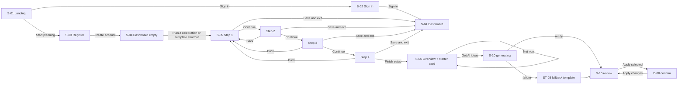

# Toranly: Google Stitch Prompt Pack

Purpose: copy-ready prompts for designing every documented screen, dialog and state in Google Stitch.
Sources of truth: [UX_FLOWS.md](../UX_FLOWS.md) (screens, routes, navigation), [design/DESIGN_SYSTEM.md](DESIGN_SYSTEM.md) (tokens and components), [PRD.md](../PRD.md) (features), [AI_SAFETY.md](../AI_SAFETY.md) (AI labelling), [ACCESSIBILITY.md](../ACCESSIBILITY.md).
This pack adds no features. Where the docs are silent, the gap is listed in section F, with a proposed default marked [Proposed].

## 0. How to use this pack in Stitch

What Stitch offers, per third-party guides read on 27 Oct 2026 (not checked against Google's own docs):
- A choice of "app" or "web" project at the start. A design-system panel for colours, fonts, spacing and roundness. A portable DESIGN.md file ([MindStudio](https://www.mindstudio.ai/blog/google-stitch-2-0-ai-design-tool)).
- Adding screens to the same project, and a prototype mode that links screens with hotspots ([MindStudio](https://www.mindstudio.ai/blog/google-stitch-2-0-ai-design-tool)).
- Follow-up prompts that keep conversation context. Specific prompts work best ([OpenReplay](https://blog.openreplay.com/prompt-ui-google-stitch/)).
- Free use with daily generation credits ([MindStudio](https://www.mindstudio.ai/blog/google-stitch-2-0-ai-design-tool)). Expect to spread this work over several days.

Working method:
1. Create one **web** project named "Toranly".
2. Paste the DESIGN.md block (section C.2) into the design-system or DESIGN.md input. Set these as project defaults.
3. Run prompt P1-1 first. Do not continue until the shell looks right; every later screen reuses it.
4. Run one prompt per screen, in phase order. Start every prompt with the line: "Use the existing Toranly design system and the app shell from screen P1-1. Do not change colours, fonts, radii or navigation."
5. For each screen, generate the desktop frame (1440 px wide) first, then ask for the mobile frame (390 px wide) with the mobile prompt that follows.
6. Use follow-up edit prompts to fix drift. Do not regenerate whole screens to fix small issues.
7. After Phase 3, link screens in prototype mode using the navigation map (section B).
8. Check each screen against the checklist in section E.

## A. Screen inventory

Routes and IDs come from UX_FLOWS.md §1. "Prompt" is the section D prompt that designs it.

| ID | Screen | Purpose | Source | Prompt |
|---|---|---|---|---|
| S-01 | Landing | Explain the product; start sign-up | UX_FLOWS §3 S-01 | P2-1 |
| S-03 | Register | Create account | S-02/S-03 | P2-2 |
| S-02 | Sign in | Start session | S-02/S-03 | P2-2 |
| S-04 | Dashboard (empty) | First-run start point | S-04, ST-04 | P2-3 |
| S-04 | Dashboard (with events) | List events, health at a glance | S-04 | P3-1 |
| S-05 | Wizard step 1: type and name | Choose event type | S-05 | P2-4 |
| S-05 | Wizard step 2: details and functions | Date, city, functions | S-05, D-11 | P2-5 |
| S-05 | Wizard step 3: budget and guests | Budget, guests, diet split | S-05 | P2-6 |
| S-05 | Wizard step 4: preferences | Themes, colours to avoid, customs, notes | S-05 | P2-7 |
| S-06 | Event overview | One-glance status, starter-plan card | S-06 | P2-8 |
| S-10 | AI plan review | Generate, review, accept, reject, apply | S-10, D-08, D-12, ST-03 | P2-9, P2-10 |
| S-07 | Budget: categories | Allocations, overspend | S-07, D-09 | P3-2 |
| S-07 | Budget: expenses | Expense log | S-07, D-04 | P3-3 |
| S-08 | Timeline | Tasks by phase, completion, dependencies | S-08, D-07 | P3-4 |
| S-09 | Vendors | Vendor list, drawer, quotes, comparison | S-09, DR-01, D-05, D-06, D-13 | P3-5, P3-6 |
| S-11 | Guests and dietary | Counts, coverage | S-11 | P3-7 |
| S-12 | Schedule | Day-of items per function | S-12, D-10, D-11 | P3-8 |
| S-13 | Ideas | Saved theme, decor, menu, saving ideas | S-13, D-14 | P3-9 |
| S-14 | Event settings | Edit details, change date, export, delete | S-14, D-03, D-01 | P3-10, P4-3 |
| S-15 | Account | Timezone, sign out, delete account | S-15 | P3-11 |
| S-16 | Not found | Recover from bad links | S-16 | P3-11 |
| D-01 | Delete confirmation | Destructive confirmation | §1.2 | P4-1 |
| D-02 | Unsaved changes | Prevent data loss | §1.2 | P4-1 |
| D-03 | Date change preview | Show task shifts before applying | §1.2 | P4-3 |
| D-04, D-05, D-06, D-07, D-09, D-10, D-11, D-14 | Form dialogs | Add and edit records | §1.2 | P4-2 |
| D-08 | Apply AI changes | Confirm what AI items will change | §1.2 | P2-10 |
| D-12 | Revise plan feedback | Feedback text for revision | §1.2 | P2-10 |
| D-13 | Quote comparison | Normalised quotes | §1.2 | P3-6 |
| DR-01 | Vendor drawer | Vendor detail and quotes | §1.2 | P3-6 |
| ST-01 | Offline banner | Connectivity loss | §2 | P4-4 |
| ST-02 | API error panel | Read failure with retry | §2 | P4-4 |
| ST-03 | AI failure and fallback | AI unavailable, refusal, limit | AI_SAFETY §6 | P2-10 |
| ST-04 | Empty states | No events, expenses, tasks, vendors, functions, ideas | §3 | P4-5 |
| ST-05 | Toasts | Save and undo feedback | §2 | P4-4 |
| ST-06 | Session expired | Re-authentication | §2 | P4-4 |
| n/a | Field validation and error summary | Invalid forms | ACCESSIBILITY §3 | P4-6 |
| n/a | Loading skeletons, busy buttons | Loading states | §2 | P4-6 |

Not designed, because the docs exclude them: vendor discovery or marketplace, guest lists with RSVP, invitations, payments, seating charts, notifications, chat assistants, dark theme, Hindi UI (PRD §4, RESEARCH_REPORT §1.4).

## B. Navigation map

### B.1 Primary journey (N-01 to N-09)


### B.2 Workspace navigation
- Sidebar and bottom bar link to: Overview S-06, Budget S-07, Timeline S-08, Vendors S-09, Guests S-11, Schedule S-12, Ideas S-13, AI plan S-10, Settings S-14. The mobile bottom bar shows Overview, Budget, Tasks, Vendors and More. More opens a sheet with Guests, Schedule, Ideas, AI plan and Settings.
- Event selector: lists the user's events, "All events" (S-04) and "New event" (S-05). It keeps the current section (N-16).
- Account menu: Account (S-15), Sign out (S-01, N-17).
- Section links on S-06 go to their screens. Empty-state AI shortcuts go to S-10 with a contract preselected: S-08 timeline.suggest, S-09 vendors.categories, S-11 menu.suggest, S-12 schedule.draft, S-13 theme.suggest.

### B.3 Branches and outcomes
| Trigger | Success | Failure or cancel |
|---|---|---|
| Any dialog Cancel or Esc | Dialog closes, focus returns to trigger | n/a |
| Save in a form dialog | Dialog closes, list updates, toast | Dialog stays open with values and inline errors |
| Leave a dirty multi-field form | D-02: Keep editing (default) or Discard | n/a |
| Change date (S-14) | D-03 preview, then Apply new date, toast, stay on S-14 | 409: "This event changed elsewhere. Reload to see the latest." |
| Delete event (S-14) | S-04 with toast "Event deleted" | Dialog error |
| Complete task | Checked, progress announced | Blocked by prerequisites: checkbox reverts, message names them |
| Delete vendor | Toast states unlinked expense count | Dialog error |
| 401 anywhere | ST-06, then S-02 with return path | n/a |
| 404 | S-16 inside the shell | n/a |
| Offline | ST-01, saves disabled, cached data visible | n/a |
| Draft event opened from any route | Wizard at saved step | n/a |

No dead ends: every screen has the shell navigation, and S-16 links to S-04 (signed in) or S-01 (signed out).

## C. Shared design brief

### C.1 Brief to paste at the top of every prompt

```
PRODUCT: Toranly, a web app for planning weddings, engagements, birthdays, anniversaries, community events and family celebrations in India. Users manage an INR budget, a task timeline tied to the event date, vendors and quotes, guest diet counts and a day-of schedule. AI suggests ideas, but the user accepts or rejects every suggestion before anything is saved.

DESIGN INTENT: This must look like a product refined by an experienced human design team, not an AI-generated SaaS template. Warm and joyful, but practical. Calm light surfaces carry the content. Saturated colour appears only for moments that matter: primary actions, milestones, the event countdown, completion feedback.

HARD RULES:
- No gradients anywhere, including text and buttons. Flat colour only.
- No glassmorphism, glows, neon, floating blobs, decorative shapes or sparkle icons.
- No purple-blue AI branding, no chatbot bubbles, no "AI-powered" badges.
- No emoji as icons. Use Lucide line icons only (2px stroke, 20px in content, 24px in navigation).
- No one-sided coloured borders on cards. Use full 1px borders or no border.
- No cards inside cards. Build hierarchy with type, spacing and alignment.
- No fake charts, vanity metrics, testimonials, logos of real companies or invented statistics.
- Every status uses an icon plus text, never colour alone.
- Money always in INR with Indian grouping: ₹18,00,000, ₹4,75,000. Compact form ₹18 L only in summary tiles.
- Dates as 14 Feb 2027. Times in 24-hour format, 19:30.
- Numbers in tables use tabular figures and are right-aligned.
- AI content is always visibly marked: "Suggested" before acceptance, "Estimate" chip on any AI money figure. Never show AI items as booked, confirmed or saved before the user applies them.
- Vendors are only ones the user added. Never show vendor ratings, reviews, photos or a marketplace.
- Light theme only.

LAYOUT VARIETY: Choose the layout that fits the content. Budget = data table with a summary bar. Timeline = grouped vertical list by planning phase. Vendors = grouped list plus a side drawer. Schedule = time-ordered agenda per function. Landing = editorial layout. Do not turn every screen into a grid of identical cards.

SHELL (signed-in screens): Desktop at 1024 px and up has a left sidebar 248 px wide on white with a full 1px right edge. At the top of the sidebar: the "Toranly" wordmark in Fraunces 600, then the event selector button showing the current event title. Nav items: Overview, Budget, Timeline, Vendors, Guests, Schedule, Ideas, AI plan, Settings. Account menu at the bottom. The active item has a #E6F2F2 background, #0F6E6E text and icon. Content max width 1120 px with 32 px page margins. Mobile under 768 px has a top app bar (back button on detail views, event selector, account icon) and a bottom bar with 5 items: Overview, Budget, Tasks, Vendors, More. Tablet 768 to 1023 px has a 72 px icon rail.

SAMPLE DATA: Use only the canonical sample data given in each prompt. Keep numbers consistent between screens.
```

### C.2 DESIGN.md for the Stitch design-system input

```
# Toranly design system (light theme)

## Colour roles
primary #0F6E6E (buttons, links, active nav, progress) | primary-hover #0B5858 | primary-active #084646 | primary-subtle #E6F2F2
secondary #3E4C9A (second chart series, focus ring)
celebration #F2A93B (fills only: milestone chips, countdown badge, completion ring; always dark text #1E2330 on it; never as text)
celebration-subtle #FFF3DC (starter card, highlight surfaces) | celebration-text #8A5A00
accent (rani) #B83A6B (countdown number, milestone flag icon; under 5% of any screen)
background #FBF8F3 | surface #FFFFFF | surface-subtle #F4EFE6 (table headers, zebra rows)
text #1E2330 | text-secondary #474F5E | text-muted #646B78
border #E3DCCF (decorative) | border-strong #8C8577 (inputs, secondary buttons)
success #1E7A46 on #E8F5EC | warning #8A5A00 on #FDF3E1 | error #B42318 on #FDECEA | info #2457A6 on #EAF1FB
focus ring 2px #3E4C9A with 2px offset | disabled text #8C8577 on #EDE8DF

## Typography
Headings h1, h2 and display: Fraunces 600. Everything else: Plus Jakarta Sans.
display 36/41 | h1 28/34 | h2 22/29 | h3 18/25 Jakarta 700 | body 16/25 Jakarta 400 | label 14/20 Jakarta 500 | small 14/20 | caption 12/17 Jakarta 500
Numbers: Jakarta 600 with tabular figures. Never use Fraunces in tables, forms or money.

## Spacing
4, 8, 12, 16, 20, 24, 32, 40, 48, 64 px. Sections separated by 32 px. Page margins 16 px mobile, 24 px tablet, 32 px desktop.

## Shape
Primary buttons, chips and segmented controls: pill (999 px). Secondary buttons, inputs, selects, menus, toasts, table panels: 12 px. Cards and panels: 16 px. Dialogs and mobile sheets: 20 px. Checkboxes 6 px. Icon-only buttons: circles, 40 px (44 px on mobile).
Shadow only on dialogs, drawers, menus and toasts: 0 8px 24px rgba(30,35,48,0.12). Cards have no shadow.

## Components
Primary button: pill, 44 px tall, #0F6E6E, white 600 label, optional leading Lucide icon. Pressed scales to 0.98.
Secondary button: 12 px radius, 44 px, white, 1px #8C8577 border, #0F6E6E label.
Tertiary: text link in #0F6E6E.
Danger: pill, #B42318, white label.
Inputs: 44 px, 12 px radius, label above, helper text below, error state with 2px #B42318 border, circle-alert icon and message.
Status chip: pill, 28 px, icon plus text, colours from the status pairs.
Estimate chip: info colours, info icon, text "Estimate".
Milestone chip: #F2A93B fill, dark text, flag icon, text "Milestone".
Tables: header row #F4EFE6, 48 px rows, numbers right-aligned.
Empty state: heading, one sentence, one primary action, optional secondary. No illustration.
Motion: 120 to 240 ms, ease-out. No page transitions, no count-up numbers, no looping decoration.
```

## D. Screen prompts

Canonical sample data, used throughout. "Today" is 27 Oct 2026.
- Main event: "Ananya & Rohan's Wedding", Wedding, Jaipur, 14 Feb 2027, 110 days to go, 250 guests, budget ₹18,00,000. Functions: Mehendi 12 Feb 16:00 to 21:00, Sangeet 13 Feb 19:00 to 23:30, Wedding 14 Feb 10:00 to 15:00, Reception 14 Feb 19:30 to 23:30.
- Budget categories (allocated / committed / paid / status): Venue ₹3,60,000 / ₹3,40,000 / ₹1,00,000 / Near limit (94%); Catering ₹4,50,000 / ₹4,75,000 / ₹50,000 / Over by ₹25,000; Decor ₹1,80,000 / ₹0 / ₹0 / OK; Attire & jewellery ₹2,16,000 / ₹0 / ₹0 / OK; Photo & video ₹1,44,000 / ₹1,32,000 / ₹30,000 / Near limit (92%); Entertainment ₹72,000; Invitations ₹36,000; Gifts & favours ₹54,000; Travel & stay ₹72,000; Ritual items ₹36,000; Contingency ₹1,80,000 (all ₹0 committed, OK). Totals: allocated ₹18,00,000, committed ₹9,47,000, paid ₹1,80,000, remaining ₹8,53,000, unallocated ₹0, overall OK.
- Guests: 250 total. Veg 150, Non-veg 70, Jain 20, Eggetarian 10, Vegan 0. Allergy tag: peanut. Accessibility: step-free access.
- Tasks: 18 of 46 done. Overdue: "Shortlist decor vendors" due 20 Oct 2026. Next: "Finalise decor vendor" 15 Nov 2026 (waiting on Shortlist decor vendors), "Book mehendi artist" 1 Dec 2026, "Send invitations" 15 Dec 2026 (Milestone), "Confirm sangeet playlist" 10 Jan 2027, "Final headcount to caterer" 4 Feb 2027.
- Vendors (entered by the user): Catering: Saffron Table Caterers (Shortlisted), quote ₹1,900 per plate x 250 = ₹4,75,000, includes service staff, live counters; Rasoi Ghar Caterers (Shortlisted), ₹1,750 per plate x 250 = ₹4,37,500, missing service staff. Venue: Amber Courtyard (Booked), ₹3,40,000 total. Photo & video: Frame Story Studio (Booked), ₹1,32,000 total.
- Other events on the dashboard: "Aarav turns 7", Birthday, Noida, 6 Dec 2026, 40 days to go, ₹75,000 budget, ₹42,000 committed, 9 open tasks. "Sector 62 Spring Get-together", Community, draft at step 2.

### Phase 1: Foundation

**P1-1 App shell and design foundation (desktop, tablet, mobile)**
```
[Paste C.1 brief]
Create the Toranly signed-in app shell as a reusable base. Show three frames: desktop 1440 px, tablet 834 px, mobile 390 px.
Desktop: left sidebar 248 px, white, with a full 1px #E3DCCF right edge. Top: "Toranly" wordmark in Fraunces 600 at 22 px, #1E2330. Below it, the event selector: a full-width 12 px-radius button with the event type icon (heart-handshake), "Ananya & Rohan's Wedding" and a chevron-down. Nav list, 44 px items with Lucide icons: Overview (house, active), Budget (wallet), Timeline (list-checks), Vendors (store), Guests (users), Schedule (clock), Ideas (bookmark), AI plan (lightbulb), Settings (settings). Bottom of the sidebar: account button with circle-user icon and "Account".
Content area on #FBF8F3: page title row with h1 "Overview" in Fraunces 600 and space for a primary action on the right. Below it, empty placeholder regions only (no fake content).
Tablet: 72 px icon rail with the same icons and tooltips; a top bar holds the event selector.
Mobile: 56 px top app bar with the event selector (title truncated) and account icon button. Bottom bar 64 px, white, top border, items Overview, Budget, Tasks, Vendors, More (ellipsis). Active item shows a #E6F2F2 pill behind the icon and a 600 label.
Include a skip link "Skip to main content" visible on focus. Show the 2px #3E4C9A focus ring on one nav item to demonstrate.
```

**P1-2 Component sheet**
```
[Paste C.1 brief]
Create one desktop frame titled "Toranly components" that shows the reusable parts in their states. Do not decorate it as a marketing page.
Rows: buttons (primary pill, secondary, tertiary, danger pill, circular icon button), each in default, hover, pressed, focus, disabled and busy (spinner replaces the leading icon, label stays). Inputs: text, money input with "₹" prefix and helper "₹18,00,000", date, select, textarea with a counter "0/500", each with an error state. Chips: status OK (circle-check, green), Near limit (triangle-alert, warning), Over (circle-alert, error), Estimate (info), Milestone (flag, marigold fill), Suggested (outline neutral), Draft (neutral). Checkbox, radio, segmented control (Open, Done, All), tabs (Categories, Expenses). Table header and two rows with right-aligned tabular rupee values. Toast (success with Undo action; error with Retry). Inline error panel. Skeleton row. Empty state block.
```

### Phase 2: Core journey

**P2-1 S-01 Landing**
```
[Paste C.1 brief]
Design the public landing page for Toranly (signed-out, no app sidebar). Desktop 1440 px.
Header: "Toranly" wordmark left; "Sign in" text link right; no other menu items.
Hero: editorial two-column layout. Left: h1 in Fraunces "Plan the celebration. Keep the numbers honest." and a one-line value statement: "Budgets in rupees that always add up, a checklist tied to your date, and ideas you approve one by one." Primary pill button "Start planning" with arrow-right icon. Right: [Proposed, see gap G2] one real-looking photograph of a festive Indian doorway with a marigold toran in warm daylight, cropped with a 16 px radius. No collage, no floating UI cards, no device mockups.
Three feature rows, alternating text and a small, real fragment of the product UI drawn in the design system (not a screenshot collage): 1) Budget that adds up: a mini budget summary showing ₹18,00,000 total, ₹9,47,000 committed, one "Over by ₹25,000" chip. 2) A timeline tied to your date: three task rows with due dates and a Milestone chip. 3) Ideas you approve: two items marked "Suggested" with Accept and Reject buttons and an "Estimate" chip. Icons: wallet, list-checks, lightbulb.
A short line under the features: "Works for weddings, birthdays, anniversaries, community events and family celebrations."
Footer: wordmark, "Sign in", "Create account". No testimonials, no pricing, no partner logos, no statistics.
Mobile 390 px: single column, photo below the hero text, full-width primary button.
```

**P2-2 S-03 Register and S-02 Sign in**
```
[Paste C.1 brief]
Design two signed-out screens with a centred 440 px form panel on #FBF8F3, wordmark above.
Register: h1 "Create your account". Fields: Email, Password (with a circular show/hide button using eye/eye-off, accessible name "Show password"; helper "At least 10 characters"), Timezone select defaulting to "Asia/Kolkata (IST)". Note under the form: "There is no password reset yet, so keep your password safe." Primary pill "Create account" full width. Link "Already have an account? Sign in".
Sign in: h1 "Welcome back". Email, Password with show/hide. Primary pill "Sign in". Link "New here? Create an account".
Also show these states as extra frames: Sign in error banner "Email or password is incorrect." (no hint which); Register error "An account with this email exists." with a "Sign in instead" link; a field error on Password "Use at least 10 characters."
Mobile: full-width panel, 16 px margins.
```

**P2-3 S-04 Dashboard, empty (first run)**
```
[Paste C.1 brief]
Signed-in shell from P1-1, but with no event selected: the sidebar shows only the wordmark, a "New event" button and Account. Page title h1 "Your events".
Empty state, left-aligned in the content column, no illustration: h2 "No celebrations yet", sentence "Start with an event type and we'll set up a budget and checklist for you.", primary pill "Plan a celebration" (plus icon). Below, label "Or start from" and three secondary buttons with icons: Wedding (heart-handshake), Birthday (cake), Community event (tent). Each opens the wizard with that type preselected.
Mobile: same content stacked; the bottom bar is hidden because there is no event yet [Proposed, gap G9].
```

**P2-4 S-05 Wizard step 1: type and name**
```
[Paste C.1 brief]
Wizard layout, not the full app shell: a slim top bar with the wordmark, "Save and exit" tertiary link right. Centred column, max width 640 px.
Progress: "Step 1 of 4" with four named steps (Type, Details, Budget & guests, Preferences) as a horizontal stepper; the current step is primary, future steps are muted.
h1 "What are you celebrating?". Six radio cards in a 3 x 2 grid (2 x 3 on mobile), each 16 px radius, with a Lucide icon and label: Wedding (heart-handshake), Engagement (gem), Birthday (cake), Anniversary (heart), Community event (tent), Family celebration (house-heart). Selected card: 2px #0F6E6E border, #E6F2F2 fill, check icon top-right.
Field "Event name", placeholder-free, helper "You can change this later." Example value "Ananya & Rohan's Wedding".
Footer: primary pill "Continue" (right), no Back on step 1.
Error frame: no type selected: "Choose an event type." above the cards, with an error summary at the top.
```

**P2-5 S-05 Wizard step 2: details and functions**
```
[Paste C.1 brief]
Same wizard layout. Stepper on step 2, step 1 shown as completed and clickable.
h1 "When and where?". Fields: Event date (date input, value 14 Feb 2027, helper "Dates before today aren't allowed."), City (optional, "Jaipur").
Section h2 "Functions" with helper "Add the separate functions of your celebration, like mehendi or reception." Shown expanded because the type is Wedding. List of 4 functions as compact rows: Mehendi, 12 Feb 2027, 16:00 to 21:00; Sangeet, 13 Feb 2027, 19:00 to 23:30; Wedding, 14 Feb 2027, 10:00 to 15:00; Reception, 14 Feb 2027, 19:30 to 23:30. Each row has a circular edit (pencil) and delete (trash-2) icon button with accessible names. Secondary button "Add function" (plus).
Footer: secondary "Back" left, primary pill "Continue" right.
Also show the D-11 function dialog over this screen: title "Add function", fields Name, Date, Start time, End time (both optional; helper "End must be after start."), buttons "Cancel" and "Save function".
```

**P2-6 S-05 Wizard step 3: budget and guests**
```
[Paste C.1 brief]
Same wizard layout, step 3.
h1 "Budget and guests". Field "Total budget" with a ₹ prefix, value 1800000, and a live formatted preview below: "₹18,00,000 (18 lakh)". Field "Expected guests": 250.
Collapsed disclosure "Add food preferences (optional)" shown expanded in this frame: number steppers with minus and plus buttons for Veg 150, Non-veg 70, Jain 20, Eggetarian 10, Vegan 0. Live check line with icon: "250 of 250 guests assigned".
Footer: Back and Continue.
Error frame: diet counts total 270: the check line turns to error: "Diet counts are 20 more than your guest total." and the steppers' group shows the error.
```

**P2-7 S-05 Wizard step 4: preferences**
```
[Paste C.1 brief]
Same wizard layout, step 4.
h1 "Make it yours". Theme words: chip input, up to 5, values "marigold", "courtyard", "warm lights". Colours to avoid: chip input, value "black". Customs to include: chip input, optional, helper "Only what you choose is used. We never assume customs." value "haldi", "pheras". Notes: textarea with counter "86/500".
Footer: Back, and primary pill "Finish setup".
Busy frame: "Finish setup" in busy state with spinner, fields disabled.
```

**P2-8 S-06 Event overview**
```
[Paste C.1 brief]
Use the P1-1 shell, Overview active. Event: Ananya & Rohan's Wedding.
Header block (not a card): h1 "Ananya & Rohan's Wedding", meta line "Wedding · Jaipur · 14 Feb 2027", and a countdown: "110" in Fraunces 600 at 36 px in #B83A6B with the label "days to go" beside it.
Starter-plan banner below the header, full width, #FFF3DC surface, 16 px radius, no border accent: "Your starter plan is ready. Want ideas from AI for themes, menus and tasks?" Primary pill "Get AI ideas" (lightbulb) and tertiary "Not now".
Then four sections on the page background, separated by 32 px, each with an h2 and a tertiary link on the right. Do not wrap them in identical cards:
1) Budget health. Three figures in a row: Allocated ₹18,00,000, Committed ₹9,47,000, Remaining ₹8,53,000. A horizontal bar showing committed vs total with a text label. Below: "2 categories need attention: Catering over by ₹25,000, Venue at 94%." Link "View budget".
2) Next tasks. Five rows with checkboxes: "Shortlist decor vendors", Overdue chip, due 20 Oct 2026; "Finalise decor vendor" 15 Nov 2026, hint "Waiting on: Shortlist decor vendors"; "Book mehendi artist" 1 Dec 2026; "Send invitations" 15 Dec 2026 with Milestone chip; "Confirm sangeet playlist" 10 Jan 2027. Progress text "18 of 46 done". Link "View timeline".
3) Vendors. Text summary: "2 booked · 2 shortlisted · 0 dropped". Link "View vendors".
4) Guests. "250 guests · Veg 150 · Non-veg 70 · Jain 20 · Eggetarian 10". Warning line with triangle-alert: "No menu ideas for Jain guests yet." Link "View guests".
Desktop: Budget health full width; Next tasks and Vendors/Guests in a 2:1 split below. Mobile: single column in this order: countdown, starter banner, budget, next tasks, guests, vendors.
```

**P2-9 S-10 AI plan review: generating and review**
```
[Paste C.1 brief]
Use the shell, AI plan active. h1 "AI plan".
Toolbar row: a select labelled "Suggest" with value "Full plan" (other options: Budget split, Tasks, Theme and decor, Menu, Vendor types, Saving ideas, Day-of schedule), primary pill "Generate" (lightbulb), and a revision select "Revision 2 · today, 14:05".
Frame A, generating: an inline progress panel with a thin indeterminate bar in #0F6E6E and staged text "Drafting suggestions…", with the earlier steps listed as done with a check: "Reading your event details". Generate button in busy state. No spinner overlay over the whole page.
Frame B, review: a note line with the info icon: "Suggestions are not saved until you apply them." Items grouped under h3 headings with counts:
Tasks (3): "Book mehendi artist", due 1 Dec 2026; "Order welcome boards", due 20 Jan 2027; "Arrange a backup generator for the courtyard", due 30 Jan 2027.
Theme and decor (2): "Marigold courtyard: strings of marigold and mango leaves over the entrance, warm fairy lights", with Estimate chip "₹45,000 to ₹70,000"; "Brass and jasmine table settings", Estimate "₹20,000 to ₹35,000".
Menu (3): "Paneer tikka", tags Veg, Jain; "Dal makhani", tags Veg; "Chicken seekh kebab", tags Non-veg.
Saving ideas (1): "Reuse sangeet stage decor for the reception", Estimate saving "₹20,000 to ₹35,000", trade-off "Same look in both photos."
Each item has a "Suggested" chip and two toggle buttons: Accept (check) and Reject (x). Show two items accepted (Accept pressed, filled primary-subtle) and one rejected (muted text, with an inline optional field "Why? (optional)").
Assumptions panel under the list, plain text: "Guest count may change by about 10%." 
Sticky footer bar: "2 selected", secondary "Revise with feedback", primary pill "Apply selected".
Mobile: toolbar stacks; Accept and Reject are full-width paired buttons per item; the footer bar sits above the bottom navigation.
```

**P2-10 S-10 dialogs and AI failure states**
```
[Paste C.1 brief]
Over the S-10 review screen, design these frames:
1) D-08 Apply changes dialog, 20 px radius, 560 px: title "Apply 5 suggestions?", list "3 tasks added to your timeline", "2 ideas saved to Ideas". A table "Budget changes" with columns Category, Current, New, for one budget-split example: Decor ₹1,80,000 to ₹2,00,000; Contingency ₹1,80,000 to ₹1,60,000. Note: "Completed tasks, expenses, vendors and guest counts are never changed." Buttons "Cancel" and primary "Apply changes".
2) Success state on the page: the applied items show an "Added" chip with circle-check, and a toast "5 suggestions added" with the action "View timeline".
3) Reject toast: "Suggestion rejected" with action "Undo".
4) D-12 Revise dialog: title "Revise the plan", textarea "What should change?" with counter "0/500", example text "Fewer decor items, more budget for food.", buttons Cancel and primary "Create revision".
5) ST-03 fallback: an info panel "AI is unavailable right now. Here is our standard template instead." with the list labelled "Standard template" instead of "Suggested", and a secondary button "Try AI again".
6) ST-03 limit: "You have used today's AI suggestions. Try again tomorrow." with a Close button.
7) ST-03 timeout: "This took too long. Nothing was changed." with Retry.
8) Empty S-10: "No suggestions yet. Choose what you want ideas for and select Generate."
```

### Phase 3: Remaining screens

**P3-1 S-04 Dashboard with events**
```
[Paste C.1 brief]
Shell with the sidebar showing the event selector set to "All events". h1 "Your events", primary pill "Plan a celebration" right.
Event list as rows on one white panel (16 px radius, 1px border), not a card grid on desktop: each row shows the type icon, title, date and days to go, a budget line "₹9,47,000 of ₹18,00,000 committed" with a status chip, and "28 open tasks". Rows:
1) Ananya & Rohan's Wedding · Jaipur · 14 Feb 2027 · 110 days to go · OK chip · 28 open tasks.
2) Aarav turns 7 · Noida · 6 Dec 2026 · 40 days to go · "₹42,000 of ₹75,000 committed" · OK · 9 open tasks.
3) Sector 62 Spring Get-together · Draft chip · "Continue setup" tertiary link (goes to wizard step 2).
Sort order: nearest date first, drafts after dated events [Proposed, gap G10].
Mobile: each event becomes a stacked block with dividers; the whole block is one link.
```

**P3-2 S-07 Budget: categories tab**
```
[Paste C.1 brief]
Shell, Budget active. h1 "Budget". Tabs: Categories (active), Expenses.
Summary bar under the tabs, sticky on desktop, label-over-value pairs: Total ₹18,00,000 · Allocated ₹18,00,000 · Committed ₹9,47,000 · Paid ₹1,80,000 · Remaining ₹8,53,000 · Unallocated ₹0, and an overall OK chip.
Data table on a white panel. Caption "Budget categories". Columns: Category, Allocated, Committed, Paid, Remaining, Status, Actions. Use the canonical 11 categories. Catering row: Remaining "−₹25,000" in error colour and chip "Over by ₹25,000". Venue: chip "Near limit (94%)". Photo & video: "Near limit (92%)". Others OK. Allocated cells look editable (subtle pencil on hover). Show one row in inline edit mode: a 44 px number input with ₹ prefix and a hint "Enter to save, Esc to cancel".
Actions column: circular ellipsis button per row, accessible name "Actions for Catering". Show its open menu: Rename, Move up, Move down, Delete.
Secondary button "Add category" above the table, right.
Frame 2: allocation warning: the user raised Decor by ₹25,000, so a persistent inline warning with triangle-alert appears above the table: "Allocations exceed your total by ₹25,000." (Not a toast.)
Mobile: the table reflows into stacked rows: category name and status chip on the first line, then label-value pairs for Allocated, Committed, Paid and Remaining. The summary bar becomes a 2-column grid above the list.
```

**P3-3 S-07 Budget: expenses tab and D-04**
```
[Paste C.1 brief]
Budget screen, Expenses tab active, same summary bar.
Filters row: Category select (All), Kind segmented control (All, Planned, Quoted, Paid). Primary pill "Add expense".
Table: Date, Description, Category, Vendor, Kind, Amount, Actions. Rows: 02 Nov 2026 · Caterer advance · Catering · Saffron Table Caterers · Paid · ₹50,000. 28 Oct 2026 · Venue advance · Venue · Amber Courtyard · Paid · ₹1,00,000. 25 Oct 2026 · Venue booking · Venue · Amber Courtyard · Quoted · ₹3,40,000. 25 Oct 2026 · Catering quote · Catering · Saffron Table Caterers · Quoted · ₹4,75,000. 20 Oct 2026 · Photo and video package · Photo & video · Frame Story Studio · Quoted · ₹1,32,000. 20 Oct 2026 · Photographer advance · Photo & video · Frame Story Studio · Paid · ₹30,000.
Kind shown as a neutral text chip, not colour-coded.
Frame 2: D-04 "Add expense" dialog: Description, Amount (₹ prefix), Kind radios (Planned, Quoted, Paid), Category select, Vendor select (optional), Date, Note (optional, counter). Buttons Cancel and primary "Save expense". Show an error on Amount: "Enter an amount above ₹0."
Frame 3: empty Expenses: "No expenses yet. Add your first planned or paid amount." with "Add expense".
Mobile: rows reflow to stacked blocks; dialog becomes a bottom sheet with 20 px top corners.
```

**P3-4 S-08 Timeline and D-07**
```
[Paste C.1 brief]
Shell, Timeline active. h1 "Timeline", progress text "18 of 46 done" with a thin progress bar, primary pill "Add task".
Segmented control: Open (active), Done, All.
Vertical list grouped by planning phase headings (h3, with a small count): "Overdue" (1), "3 months before" , "2 months before", "1 month before", "Final week", "Event day". Rows: checkbox, title, due date right-aligned, optional chips (Overdue with circle-alert; Milestone with flag), dependency hint in text-secondary ("Waiting on: Shortlist decor vendors"), ellipsis menu (Edit, Move up, Move down, Delete).
Use the canonical tasks, plus "Book hotel rooms for out-of-town family" (1 month before) and "Pack ritual items kit" (Final week).
Frame 2: a just-completed row showing a check with a short marigold ring around the checkbox (completion feedback) and the progress now "19 of 46 done".
Frame 3: blocked completion: "Finalise decor vendor" checkbox reverted, inline message with circle-alert "Finish 'Shortlist decor vendors' first."
Frame 4: D-07 "Add task" dialog: Title; Due date mode radio "Days before event" (value 45) or "Specific date"; Category select; Milestone toggle; Prerequisites multi-select; Notes. Error example on Prerequisites: "This would create a loop between tasks." Buttons Cancel, "Save task".
Empty frame: "No tasks yet" with "Add task" and secondary "Get AI task ideas".
Mobile: groups stay; chips wrap below the title; menu opens as a bottom sheet.
```

**P3-5 S-09 Vendors list**
```
[Paste C.1 brief]
Shell, Vendors active. h1 "Vendors", primary pill "Add vendor".
Category filter chips: All, Catering, Venue, Photo & video, Decor.
List grouped by category (h3). Each row: vendor name, status chip (Booked: circle-check success; Shortlisted: neutral; Dropped: muted), best quote text "₹4,75,000 total", phone as a link with phone icon. Group header for Catering has a secondary button "Compare quotes" (enabled because there are 2 quotes).
Rows: Catering: Saffron Table Caterers (Shortlisted, ₹4,75,000), Rasoi Ghar Caterers (Shortlisted, ₹4,37,500). Venue: Amber Courtyard (Booked, ₹3,40,000). Photo & video: Frame Story Studio (Booked, ₹1,32,000). Decor: no vendors, inline text "No decor vendors yet."
No ratings, reviews, photos or "discover vendors" sections.
Empty frame: "No vendors yet" with "Add vendor" and secondary "Which vendors do I need?".
D-05 dialog frame: Category, Name, Phone (optional), Email (optional), Status radios, Notes. Buttons Cancel, "Save vendor".
Mobile: rows stacked; Compare quotes moves under the group heading.
```

**P3-6 S-09 vendor drawer, quotes and comparison**
```
[Paste C.1 brief]
Over the Vendors screen, design:
1) DR-01 right drawer, 440 px, 20 px inner-edge radius, overlay shadow: header "Saffron Table Caterers", status chip, close (x). Details: Category Catering, Phone, Email, Notes. Buttons Edit (secondary), Delete (tertiary, error colour). Section "Quotes": one quote row "₹1,900 per plate × 250 = ₹4,75,000 · Valid until 1 Dec 2026", inclusions chips "Service staff", "Live counters". Secondary "Add quote".
2) D-06 Add quote dialog: Amount, Pricing unit select (Total, Per plate, Per guest), Units (shown when not Total), Inclusions chip input, Valid until. Error example: "Enter the number of plates."
3) D-13 Compare quotes dialog for Catering, guest basis 250: table Vendor, Total, Per guest, Missing inclusions, Valid until. Rasoi Ghar Caterers ₹4,37,500 · ₹1,750 · "Service staff" · 1 Dec 2026, marked "Lowest" with an icon and text. Saffron Table Caterers ₹4,75,000 · ₹1,900 · none · 1 Dec 2026. Note: "Prices are the quotes you entered."
4) D-01 delete vendor: "Delete Saffron Table Caterers?" body "1 expense will stay in your budget without a vendor." Buttons Cancel (default focus) and danger "Delete vendor".
Mobile: drawer becomes a full-screen sheet with a back arrow.
```

**P3-7 S-11 Guests and dietary**
```
[Paste C.1 brief]
Shell, Guests active. h1 "Guests and food".
Form section "Headcount": Total guests 250. "Diet split" as a row of labelled number steppers: Veg 150, Non-veg 70, Jain 20, Eggetarian 10, Vegan 0. Check line: "Diet counts: 250 of 250 guests".
"Allergies": chip input with "peanut". "Accessibility needs": checkboxes Step-free access (checked), Seating support, Hearing support, Visual support, Other.
Coverage panel (plain section, not a nested card): "Menu ideas cover: Veg, Non-veg." Warning line: "Missing: Jain, Eggetarian." Links "View ideas" and secondary button "Get menu ideas".
Primary pill "Save guest details" at the end of the form.
Error frame: total 250, diets sum 270: error on the diet group "Diet counts are 20 more than your guest total."
Mobile: steppers in a 2-column grid.
```

**P3-8 S-12 Schedule**
```
[Paste C.1 brief]
Shell, Schedule active. h1 "Schedule", secondary "Add function".
One section per function as an agenda: h2 "Wedding · 14 Feb 2027 · 10:00 to 15:00", with "Add item" and a secondary "Draft with AI". Items in a time column layout (time on the left in tabular figures, title and duration right): 10:00 Baraat arrival (45 min); 10:45 Jaimala (30 min); 11:15 Pheras (90 min); 12:30 Lunch (90 min) with a warning chip "Overlaps with Pheras". Each item has an ellipsis menu (Edit, Move up, Move down, Delete).
Show the Mehendi and Reception sections collapsed below with item counts.
D-10 Add item dialog: Start time, Duration in minutes, Title, Notes. Error example: "Starts after this function ends (15:00)."
Empty frame: "Add a function to start your schedule." with "Add function".
Mobile: time stays in a narrow left column; sections stack.
```

**P3-9 S-13 Ideas**
```
[Paste C.1 brief]
Shell, Ideas active. h1 "Ideas", primary pill "Add idea".
Filter chips: All, Theme, Decor, Menu, Saving, Other.
A two-column masonry-free list on desktop (equal rows, not cards with shadows): each idea shows a kind label, title, description, diet tags for menu ideas, an Estimate chip with a range if present, source text "AI idea" or "Your idea", and an ellipsis menu with Delete only.
Ideas: Marigold courtyard (Theme, AI idea, Estimate ₹45,000 to ₹70,000); Paneer tikka (Menu, Veg, Jain, AI idea); Chicken seekh kebab (Menu, Non-veg, AI idea); "Family photo wall with old wedding pictures" (Decor, Your idea); Reuse sangeet stage decor (Saving, Estimate saving ₹20,000 to ₹35,000).
D-14 Add idea dialog: Kind select, Title, Details textarea. Buttons Cancel, "Save idea".
Empty frame: "No ideas saved yet" with secondary "Get theme ideas".
Mobile: single column.
```

**P3-10 S-14 Event settings**
```
[Paste C.1 brief]
Shell, Settings active. h1 "Event settings". Sections separated by dividers, not cards:
1) Details form: Event name, City, Expected guests, Total budget (₹), Theme words, Colours to avoid, Customs, Notes. Primary pill "Save changes".
2) Date: "14 Feb 2027" with secondary button "Change date" (calendar-clock).
3) Functions: list of the 4 functions with edit and delete icon buttons, "Add function".
4) Export: secondary buttons "Download budget CSV" and "Download tasks CSV" (download icon).
5) Danger zone: text "Deleting removes the event and everything in it." Danger pill "Delete event".
Frames: conflict banner "This event changed elsewhere. Reload to see the latest." with "Reload"; toast "Download started"; D-01 delete event dialog requiring the user to type the event name, with the danger button disabled until it matches.
```

**P3-11 S-15 Account and S-16 Not found**
```
[Paste C.1 brief]
S-15 Account (shell with no event context): h1 "Account". Email shown read-only. Timezone select "Asia/Kolkata (IST)" with "Save". Secondary "Sign out" (log-out). Danger zone: "Delete account" opening D-01 that requires typing DELETE, body "This deletes all your events and cannot be undone."
S-16 Not found inside the shell: h1 "Page not found", sentence "The link may be old or mistyped.", primary pill "Go to your events". Signed-out variant without the shell links to "Go home".
```

### Phase 4: States and dialogs

**P4-1 D-01 and D-02 confirmations**
```
[Paste C.1 brief]
Design the confirmation dialogs as a set, 560 px, 20 px radius, dark overlay rgba(30,35,48,0.48):
D-01 delete expense: "Delete this expense?" "Caterer advance, ₹50,000." Cancel (default focus), danger "Delete".
D-01 delete category with expenses (blocked): "Catering has 2 expenses" "Move or delete its expenses first." single button "OK".
D-02 unsaved changes: "Discard changes?" "You have unsaved changes in this form." Primary "Keep editing" (default focus) and tertiary "Discard".
Mobile: each becomes a bottom sheet; buttons full width, primary on top.
```

**P4-2 Form dialog family**
```
[Paste C.1 brief]
Show the form dialogs side by side so they match: D-09 Category (Name, Allocation ₹), D-11 Function, D-10 Schedule item, D-07 Task, D-04 Expense, D-05 Vendor, D-06 Quote, D-14 Idea. Same header style, field spacing (16 px), footer with Cancel and a specific primary label ("Save category", "Save function", and so on). One dialog in saving state: primary busy, fields disabled, Esc hint hidden.
```

**P4-3 D-03 Date change preview**
```
[Paste C.1 brief]
On S-14, dialog "Change event date". Field New date: 1 Mar 2027 (was 14 Feb 2027). Checkbox "Also move tasks with fixed dates" (unchecked). Preview list after the date is entered: "26 tasks will move by 15 days", sample rows "Book mehendi artist: 1 Dec 2026 to 16 Dec 2026", "Send invitations: 15 Dec 2026 to 30 Dec 2026"; "2 tasks with fixed dates stay as they are"; "0 tasks become overdue". Buttons Cancel and primary "Apply new date". Loading state for the preview: skeleton rows. Success: toast "Event date changed to 1 Mar 2027".
```

**P4-4 Global states**
```
[Paste C.1 brief]
On the Budget screen, design: ST-01 offline banner fixed under the top bar, info colours with a wifi-off icon: "You're offline. Changes can't be saved right now." Save buttons disabled with a hint. ST-02 error panel inside the expenses region: error-subtle surface, 16 px radius, circle-alert, "We couldn't load your expenses." "Check your connection and try again." secondary "Retry"; the summary bar above still shows data. ST-05 toasts: success "Expense saved" (auto-hides), error "Couldn't save. Try again." with Retry (stays). ST-06 session dialog: "Your session ended. Sign in again." primary "Sign in".
```

**P4-5 Empty states set**
```
[Paste C.1 brief]
Show the empty states together, in context of their screens, so their tone and layout match: Dashboard, Expenses, Timeline, Vendors, Schedule, Ideas, AI plan. Each has heading, one sentence, one primary action and at most one secondary action. No illustrations, no large icons, left-aligned with the content column.
```

**P4-6 Validation and loading**
```
[Paste C.1 brief]
On the wizard step 3 form: error summary box at the top "Fix 2 fields to continue" with links to the fields; field errors under Total budget "Enter an amount of ₹0 or more." and Expected guests "Enter at least 1 guest." Required fields marked with "(required)" text.
Loading: the Overview screen with skeleton blocks in #F4EFE6 for each section (static shapes, no shimmer gradient), and a button in busy state.
```

### Phase 5: Responsive refinement

**P5-1 Mobile pass (repeat per screen)**
```
Create the mobile (390 px) version of this screen using the same design system and the P1-1 mobile shell. Do not shrink the desktop layout. Put the primary action within thumb reach, make all touch targets at least 44 x 44 px, reflow tables into stacked label-value rows, turn dialogs into bottom sheets with 20 px top corners, keep the bottom bar visible except while a sheet is open.
```

**P5-2 Tablet pass**
```
Create the 834 px tablet version using the 72 px icon rail. Keep two-column layouts only where both columns stay at least 320 px wide; otherwise stack.
```

**P5-3 Consistency audit prompt**
```
Review all screens in this project. List and fix any place that uses a gradient, a shadow on a card, a one-sided border, a colour outside the design system, Fraunces in a table or form, an emoji, a status shown by colour alone, or an AI item that looks saved before it is applied. Do not change anything else.
```

## E. Flow validation checklist

Journeys
- [ ] J-01: Landing to Register to empty Dashboard to Wizard 1 to 4 to Overview, linked in prototype mode.
- [ ] J-02: Overview "Get AI ideas" to AI plan generating to review to D-08 to applied state; reject with undo; revise via D-12.
- [ ] J-03: Settings "Change date" to D-03 preview to applied toast.
- [ ] J-04: Budget expense added until Catering shows "Over by ₹25,000".
- [ ] J-05: Vendors add vendor, open drawer, add quote, compare, delete with unlinked-expense message.
- [ ] J-06: Offline banner, error panel with Retry, session expired.

Navigation
- [ ] Every sidebar and bottom-bar item reaches its screen; More sheet lists the remaining 5.
- [ ] Event selector shows "All events" and "New event".
- [ ] Wizard Back, Save and exit, and completed-step links work; no Back on step 1.
- [ ] Every dialog has Cancel and a specific primary label.
- [ ] Every empty-state AI shortcut goes to AI plan with the right "Suggest" value.
- [ ] S-16 offers a way back. No screen is a dead end.

Content and rules
- [ ] Sample numbers match across Overview, Budget, Dashboard and Vendors.
- [ ] Every money value uses ₹ and Indian grouping.
- [ ] All AI money values carry an Estimate chip; unapplied items say "Suggested".
- [ ] No vendor ratings, reviews, photos or marketplace.
- [ ] No notifications bell, chat bubble, testimonials, pricing or fake charts.
- [ ] Every status pairs icon and text.
- [ ] No gradients, card shadows, one-sided borders or emoji.
- [ ] Fraunces only in h1, h2 and the countdown.
- [ ] Primary buttons are pills; inputs 12 px; cards 16 px; dialogs 20 px.
- [ ] Focus ring visible on at least one control per screen in the component sheet.
- [ ] Mobile frames exist for every screen, with 44 px targets and reflowed tables.

## F. Documentation gaps

| ID | Gap | Affects | Proposed default (needs your approval) |
|---|---|---|---|
| G1 | The docs still use the temporary name "Celebration & Event Planner" and `APP_DISPLAY_NAME`. The naming research did not complete a trademark or domain check for Toranly | All docs | Set `APP_DISPLAY_NAME=Toranly` and update headings; keep trademark clearance as an open task |
| G2 | DESIGN_SYSTEM.md says "No illustrations in MVP" for empty states, but no rule covers photography on the landing page. The CSP also only allows self-hosted images | S-01 | Allow one licensed, self-hosted photograph on S-01 only; none inside the app |
| G3 | No logo or wordmark is defined | Shell, S-01 to S-03 | Text wordmark "Toranly" in Fraunces 600 until a logo is designed |
| G4 | Ideas and AI plan both use the `lightbulb` icon in the icon map | Navigation | Ideas = `bookmark`, AI plan = `lightbulb` |
| G5 | S-10 does not say what happens to pending items in the current revision when the user selects Generate again | S-10 | Pending items stay in the old revision; the new revision becomes the selected one |
| G6 | Ideas can be added and deleted but not edited (no PATCH endpoint) | S-13 | Keep add and delete only for MVP |
| G7 | A category with expenses can't be deleted, and there is no "move all expenses" action; users edit each expense | S-07 | Keep as documented; the blocked dialog explains it |
| G8 | `events.status = completed` exists, but no UI or rule sets it | S-04 | Treat events with past dates as "Past" in a separate group; no completed toggle in MVP |
| G9 | The mobile shell before any event exists (empty dashboard) is not described | S-04 empty, S-15 | Hide the bottom bar until an event exists; show the top bar with account only |
| G10 | Dashboard sort order for drafts is not defined (UX says nearest upcoming first, past last) | S-04 | Dated upcoming, then drafts, then past |
| G11 | The event selector has a "search" icon in the icon map, but the UX describes a plain listbox | Shell | Plain listbox; add a filter field only when there are more than 8 events |
| G12 | Lucide icon names (`house-heart`, `tent`, `heart-handshake`, `calendar-clock`, `wifi-off`, `bookmark`) are unverified against lucide.dev | All | Verify during design handoff; substitute same-meaning icons if missing |
| G13 | The landing page content beyond hero, three feature rows and footer is not specified | S-01 | Keep exactly that; no extra sections |
| G14 | Copy text across empty and error states has not had a writing pass with real users (IMPLEMENTATION_PLAN O-3) | All states | Use the copy in this pack as a draft |
